# contraction 范式 basic DAG 分析和 Buffer 划分

公共不变量见 [Contraction 公共契约](../../common-contract.md)；本页负责基础模板的具体实例与策略。

## 1 DAG 分析和 Buffer 划分方案

### 1.1 基础场景与数据流

本基础场景计算矩阵乘：

`C[m,n] = sum(k=0..K-1, A[m,k] * B[k,n])`。

M、N 是保留的输出指标，K 是两输入对齐并求和消去的指标。输出有 M×N 个独立结果；每个结果依赖完整 K。无需物化 `[M,N,K]` 的乘积张量。

本基础实例采用正 M/N/K，A/B 按各自选定轴顺序连续存储，C 按 [M,N] 连续存储，输入类型记为 Tin，累加类型为 Tacc，输出类型为 Tout；沿 M/N 分核，每个输出块由一个核完成完整 K，A/B 双侧流式输入，L0C 直接写 GM。

逻辑坐标始终记为 A(m,k)、B(k,n)、C(m,n)，存储轴顺序如下：

| 张量 | 存储轴顺序 | 元素偏移 |
|---|---|---|
| A | [M,K] | `m*K+k` |
| A | [K,M] | `k*M+m` |
| B | [K,N] | `k*N+n` |
| B | [N,K] | `n*K+k` |
| C | [M,N] | `m*N+n` |

A/B 的两个选择相互独立，形成 4 种输入存储组合；C 按 [M,N] 连续存储。输入转置改变读取步长，逻辑 M/N 分块与完整 K 累加保持一致。

输入与累加类型作为同一基础模板的参数：

| A/B 输入 Tin | 累加 Tacc | 输入元素字节数 | 累加元素字节数 |
|---|---|---:|---:|
| FP16 | FP32 | 2 | 4 |
| BF16 | FP32 | 2 | 4 |
| INT8 | INT32 | 1 | 4 |

Tout 由输出契约确定，独立于 Tacc；写回时按该契约处理类型转换。三种组合共享输出分块、K 累加和 buffer 生命周期，物理布局、对齐与指令能力按类型取得。后续数值推导以 BF16 输入、FP32 累加、BF16 输出及 A[M,K]、B[K,N]、C[M,N] 存储为例。

```text
A GM[M,K] ──MTE2──> A L1[ML1,KL1] ──MTE1──> A L0A[ML1,KL0] ─┐
                                                        ├─MMAD─> L0C[ML1,NL1] ──输出通路──> C GM[M,N]
B GM[K,N] ──MTE2──> B L1[KL1,NL1] ──MTE1──> B L0B[KL0,NL1] ─┘           Tacc                   Tout
```

分块命名见 [术语表](../../../terminology.md)。本模板取 ML0=ML1、NL0=NL1，每个任务在核内不再沿 M/N 切分。常规输出块为 ML1×NL1；边缘与尾轮子任务的有效尺寸由调度给出，各级数据窗口随当前任务的有效尺寸建立。

#### 1.1.1 分块、偏移与计数命名

| 类别 | 名称 | 含义与单位 |
|---|---|---|
| 分块尺寸 | ML1、NL1、KL1、KL0 | 对应存储层的轴长度，单位为元素 |
| 任务起点 | mTaskOffset、nTaskOffset | 当前任务在全局 M/N 上的元素偏移 |
| 窗口起点 | kL1Offset、kL0Offset | 前者相对全局 K，后者相对当前 L1 窗口，单位为元素 |
| 有效长度 | mTaskValid、nTaskValid、kL1Valid、kL0Valid | 当前任务或窗口内有效元素数 |
| 任务调度 | coreId、taskRound、taskId、coreCount、taskCount | 核号、核内任务轮次、任务序号及对应数量 |
| 窗口内坐标 | mInTask、nInTask、kInL1、kL0Element | 分别相对输出任务、L1 窗口或 L0 窗口 |
| 物理槽 | l1SlotId、l0SlotId | 两级输入槽编号，分别轮转 |
| GM 地址 | aGmBase、aTaskBase、aL1WindowGmBase | A 张量原始、任务、L1 窗口的 GM 字节基址；B 同理，C 使用原始与任务基址 |
| 布局步长 | aStrideM、aStrideK 等 | 沿逻辑轴移动一元素对应的存储元素跨度 |
| 资源大小 | inputElemBytes、accElemBytes、aL1SlotBytes 等 | 元素宽度或单槽物理跨度，单位为字节 |

数学公式保留 M/N/K 和 m/n/k。局部布局公式的 i/j 表示行列坐标，仅在该公式内使用。

### 1.2 存活节点分析

#### 1.2.1 逻辑存活节点

逻辑节点按数据角色计数，不因双缓冲增加：A、B 是输入，C 是沿 K 持续更新的部分和。按存储层观察本模板的数据角色如下；同一操作数经过多级存储不增加数学 DAG 的节点。

| 存储层 | 逻辑节点 | 层内逻辑节点数 | 存活区间 |
|---|---|---:|---|
| UB | 不涉及 | 0 | — |
| L1 | A 输入窗口、B 输入窗口 | 2 | gm2l1 生产至该窗口最后一次 l12l0 消费完成 |
| L0A | A 计算输入窗口 | 1 | l12l0 生产至使用该窗口的乘加完成 |
| L0B | B 计算输入窗口 | 1 | l12l0 生产至使用该窗口的乘加完成 |
| L0C | C 部分和/最终结果 | 1 | 首次累加写入至结果输出消费完成 |

C 的部分和与最终结果是同一逻辑节点在不同计算阶段的值。跨 KL1 窗口继续保留 C，不重新初始化。

#### 1.2.2 物理存活节点

物理节点按独立 buffer 计数，分别在各存储层核算。根据 §1.5 的双缓冲方案，A 在 L1 的两个 buffer 是两个物理节点；B 同理。不能用“A/B 两组”代替四个 buffer 的计数。

| 存储层 | 物理节点 | 物理节点数 |
|---|---|---:|
| UB | 不涉及 | 0 |
| L1 | A_ping、A_pong、B_ping、B_pong | 4 |
| L0A | A_ping、A_pong | 2 |
| L0B | B_ping、B_pong | 2 |
| L0C | C_acc | 1 |

表中数量是本模板为流水同时保留的物理 buffer 份数，用于容量核算。某槽处于空闲、写入、就绪或读取状态，不改变其已分配的物理空间；有效数据的存活区间由生产与最后消费确定。各层的同名 ping/pong 属于不同物理空间，独立轮转。

物理复用条件：L1 等最后一次 l12l0 读取完成；L0A/B 等相应乘加完成；L0C 等输出消费完成。先确定这些物理份数，再由 Tiling 求每份大小。

### 1.3 DAG VF 融合分析

不涉及。

### 1.4 额外 Buffer 要求

不涉及。

### 1.5 Double Buffer 决策

本图以目标支持搬运与计算流水并行为前提：满足依赖的不同执行资源可以同时工作。硬件执行队列说明见 [npu-arch：指令序列与 BufferID 同步](../../../../../../../../ops/npu-arch/references/npu-arch-guide.md#指令序列与-bufferid-同步)。因此，程序提交指令的先后顺序不等于所有搬运和计算串行完成。

下面用甘特图说明两级双缓冲的作用。分行使用本 Cube 实例的通路标签：`gm2l1`（GM→L1）、`l12l0`（L1→L0A/L0B）、`mmad`（矩阵乘加，累加到 L0C）、`l0c2gm`（L0C→GM）。横轴为同一起点的相对时间，每条任务显式给出开始和结束时刻。图中取完整 KL1 搬运耗时 2、半长窗口搬运耗时 1、输入准备耗时 1、乘加耗时 2；这些是调度示例的时间单位，不是硬件实测周期。支持结果单元逐步交接时，输出在最终乘加产生首批就绪单元后开始；每个 G/L 条带合并表示 A、B 两路搬运。G0…G3 对应首任务四个 L1 窗口，L0…L4 与 M0…M4 对应五个 KL0 窗口。

```mermaid
gantt
    title 首任务窗口二分与双缓冲
    dateFormat HH:mm:ss
    axisFormat %S
    tickInterval 1second
    todayMarker off
    section gm2l1
    G0 阶段0 :gm2l10, 00:00:00, 00:00:01
    G1 阶段1 :gm2l11, 00:00:01, 00:00:02
    G2 阶段0 :gm2l12, 00:00:02, 00:00:04
    G3 阶段1 :gm2l13, 00:00:04, 00:00:05
    section l12l0
    L0 L0槽0 :l12l00, 00:00:01, 00:00:02
    L1 L0槽1 :l12l01, 00:00:02, 00:00:03
    L2 L0槽0 :l12l02, 00:00:04, 00:00:05
    L3 L0槽1 :l12l03, 00:00:06, 00:00:07
    L4 L0槽0 :l12l04, 00:00:08, 00:00:09
    section mmad
    M0 累加 :mmad0, 00:00:02, 00:00:04
    M1 累加 :mmad1, 00:00:04, 00:00:06
    M2 累加 :mmad2, 00:00:06, 00:00:08
    M3 累加 :mmad3, 00:00:08, 00:00:10
    M4 累加 :mmad4, 00:00:10, 00:00:12
    section l0c2gm
    消费就绪单元 :l0c2gm0, 00:00:11, 00:00:13
```



- L1：G2 复用阶段 0 等 L0 读完，G3 复用阶段 1 等 L1 读完；每阶段容纳 A/B 两槽。
- L0：L2 复用槽 0 等 M0 完成，L3 复用槽 1 等 M1 完成；与 L1 阶段独立轮转。
- L0C：本例单槽按单元交接，M4 生成的就绪单元可先被输出消费。

本模板引用 [首块二分、配对分区与累加槽选择](../../execution-strategies.md)。本例 L0C 容量只容纳一个常规块，选择单槽结果单元交接；双槽容量与能力成立时使用公共策略的双槽整块交接。Tiling 联合选择，Kernel 按选择展开。

### 1.6 强制产出清单

逐存储层列出逻辑节点数与物理 buffer 份数。每份 buffer 记录：逻辑窗口、物理布局、数据宽度、有效数据字节、实际预留跨度、槽数、基址、对齐、生产/消费/复用条件。逻辑尺寸相同不意味着物理占用相同；固定分区按预留跨度计算。

### 1.7 Bank 冲突与物理布局

容量合法和并发访问无冲突是两个问题。需要把 MTE2 正在写的槽与 MTE1 正在读的槽投影到目标芯片的 L1 bank，检查同一时段是否竞争。仅写“ping/pong”无法证明避开 bank 冲突。

使用 [硬件 bank 映射](../../../../../../../../ops/npu-arch/references/npu-hardware-params.md) 将每个槽的实际地址范围映射到存储资源，与甘特图中的并发读写区间对照。若有争用，调整槽基址或间隔，再检查新增预留空间与对齐；各存储层分别分析。

## 2 Buffer 划分产出校验

### 2.1 贯穿实例与资源账本

三份文档统一使用 `M=256,N=384,K=640`。Tiling 的实例分块为 `ML1=NL1=128,KL1=256,KL0=128`，6 个父输出块在尾轮拆分后得到 8 个最终任务，每核首任务有 4 个 L1 数据窗口，后续任务有 3 个；本例均为 5 次 MMAD；最后一个 L1 窗口只含 128 个 K 元素。该实例用于贯穿 Buffer、Tiling 与 Kernel 的推导。

本实例 NZ/ZN 的形状和物理跨度已在 [Kernel 布局公式](kernel-template.md#34-贯穿实例的片上布局公式) 中展开；所有片上维度为 16 的倍数，无额外布局 padding。资源账本如下。若后端改用其他布局产生更大跨度，应替换本表并重新筛选候选。

| 空间 | 单槽预留字节 | 槽数 | 合计预留字节 |
|---|---:|---:|---:|
| A L1 | 64 KiB | 2 | 128 KiB |
| B L1 | 64 KiB | 2 | 128 KiB |
| L0A | 32 KiB | 2 | 64 KiB |
| L0B | 32 KiB | 2 | 64 KiB |
| L0C | 64 KiB | 1 | 64 KiB |

首轮 128×128 任务的最后一个 L1 窗口 A/B 各只有 32 KiB 有效数据，但固定槽的预留跨度保持不变。尾轮 64×128 任务的 A 数据量进一步减半，固定槽预留仍不变。各存储层分别记账。

本例两个阶段分别容纳 A/B；按 `[A_ping,A_pong,B_ping,B_pong]` 列出的槽起点为 `[0,128,64,192] KiB`。将这些实际地址代入 §1.7 的 bank 检查；调整基址时同步更新 Tiling 分配区间与 Kernel 槽基址。

### 2.2 验收要求

逐项对应真实分配位置，检查各槽边界、同时存活区间、对齐和 bank 映射。物理地址不重叠之外，还要证明复用前最后一个消费者已完成。

## 3 Bias[N] 组合扩展的 DAG 与资源

原贯穿实例保持 hasBias=false；以下为同一形状接入 Bias[N] 组合扩展。各输出块共享同一向量，按最终子任务的 N 区间取切片，并广播到每个输出行。

采用 [Bias[N] 组合扩展首段融合](../../execution-strategies.md#8-biasn-组合扩展的首段融合策略)：新增 bias GM→L1→BiasTable→首段累加依赖。L1/BiasTable 各一物理槽，逻辑 bias 向量及槽数分别记录；两空间的跨度、转换及最后消费者按该公共策略核算。无组合扩展不增加任何节点、槽或事件。

本核每个有效输出子块独立首段注入；不能把每核首任务与每个输出首 K 段混淆。
