# contraction 范式 batch DAG 分析和 Buffer 划分

执行组织及模板选择见 [多个保留轴坐标的执行组织](../../template-overview.md#25-多个保留轴坐标的执行组织)。

## 1 DAG 分析和 Buffer 划分方案

### 1.1 基础场景与数据流

`C[p,m,n] = sum_k A[broadcastA(p),m,k] * B[broadcastB(p),k,n]`。Batch 是保留指标，K 是消去指标；广播只改变输入索引，不减少输出任务。先把前导轴右对齐，对每轴检查两输入尺寸相等或其中一个为 1，再求输出 batch shape。

贯穿实例：`A[2,1,256,640]`、`B[1,3,640,384]`、`C[2,3,256,384]`，BF16 输入/输出、FP32 累加。候选 `ML1=ML0=128, NL1=NL0=128, KL1=256, KL0=128`。每批次 6 个输出块，共 36 个任务；每任务独立完成完整 K。本模板每任务使用常规 K 窗口：起点为 0、KL1、2×KL1，末窗截到 K；本例窗口长度为 256、256、128，每个任务都采用同一规则。

```text
output batch coordinate p -> broadcastA(p), broadcastB(p)
A GM window -> gm2l1 -> A L1 -> l12l0 -> L0A --+
                                               +-> MMAD -> L0C -> l0c2gm -> C[p]
B GM window -> gm2l1 -> B L1 -> l12l0 -> L0B --+
```

类型与数学规则引用 [公共契约 §1](../../common-contract.md#1-语义与数值)，存储轴顺序和布局地址引用 [§2](../../common-contract.md#2-存储与地址)，物理跨度、容量及硬件事实源引用 [§3](../../common-contract.md#3-资源描述)。本模板只定义下述具体场景、槽数和每槽内容；资源公式中的 `span(layout)` 对应公共契约的物理字节跨度。

### 1.2 存活节点分析

| 存储层 | 逻辑角色及数量 | 物理 Buffer 及份数 | 释放条件 |
|---|---|---|---|
| UB | 不涉及，0 | 0 | — |
| L1 | A/B 当前输入窗口，2 | A 两槽、B 两槽，共 4 | 当前窗口最后一次 l12l0 完成 |
| L0A | A 计算窗口，1 | 2 | 对应 MMAD 完成 |
| L0B | B 计算窗口，1 | 2 | 对应 MMAD 完成 |
| L0C | 当前输出块，1 | 1 | 完整 K 后输出完成 |

每槽只有当前任务的一个矩阵窗口。6 个 batch 不意味着每核分配 6 套 buffer；不同任务顺序复用上述槽。广播的两个任务即使读取同一 GM 地址，也不自动共享片上生命周期。

### 1.3 DAG VF 融合分析

不涉及。

### 1.4 额外 Buffer 要求

不涉及。

### 1.5 Double Buffer 决策

本例选择 L1 A/B 成对双槽、L0A/B 双槽、单 L0C 整块交接。L1 分区规则见 [成对分区](../../execution-strategies.md#2-l1-成对分区双缓冲)，L0 交接见 [输入双缓冲](../../execution-strategies.md#3-l0-输入双缓冲)。单 L0C 从本任务首次累加前持有至完整结果输出完成，再交给下一个任务。

以下用相对时间单位说明依赖：一个 KL1 搬运用 2 单位（尾窗 1），每次 l12l0 用 1，每次 MMAD 用 2，整块输出用 2。输入准备受 L0 双槽复用约束；输出在最后 MMAD 完成后开始。

```mermaid
gantt
    title Batch 单任务输入双缓冲与整块输出（相对时间）
    dateFormat X
    axisFormat %s
    section gm2l1
    K0至256 槽0 :g0, 0, 2s
    K256至512 槽1 :g1, 2, 2s
    K512至640 槽0 :g2, 4, 1s
    section l12l0
    K0至128 槽0 :l0, 2, 1s
    K128至256 槽1 :l1, 3, 1s
    K256至384 槽0 :l2, 5, 1s
    K384至512 槽1 :l3, 7, 1s
    K512至640 槽0 :l4, 9, 1s
    section mmad
    mmad K0至128 :m0, 3, 2s
    mmad K128至256 :m1, 5, 2s
    mmad K256至384 :m2, 7, 2s
    mmad K384至512 :m3, 9, 2s
    mmad K512至640 :m4, 11, 2s
    section l0c2gm
    当前任务整块输出 :c0, 13, 2s
```



跨 batch 切换是任务切换：下一任务输入可写入已归还的输入槽，首次 MMAD 等待上述输出完成。输入计数跨任务继续，本任务消费 3 个 L1 窗口、5 个 L0 窗口，下一任务分别从槽 1、槽 1 开始。

### 1.6 强制产出清单

输出 batch shape、每个输入的广播轴与真实元素步长、任务坐标表、各层单槽布局/字节/份数/最后消费者；输出广播维必须拥有不同地址。

### 1.7 Bank 冲突与物理布局

广播可提高相同 GM 数据重访率，不等于无 bank 冲突。按 [公共资源契约](../../common-contract.md#3-资源描述) 对实际输入槽基址与并发读写区间进行 bank 投影检查；L2 hint 根据 batch/SWAT 遍历产生的重访距离选择。

## 2 Buffer 划分产出校验

### 2.1 贯穿实例与资源账本

在本例候选布局无额外 padding 时：A L1 与 B L1 各 `2×128×256×2=128 KiB`；L0A/B 各 `2×128×128×2=64 KiB`；L0C `128×128×4=64 KiB`。最后 KL1 有效长度为 128，但槽预留不缩小。这是需求量，不是芯片容量。

### 2.2 验收要求

按 [Tiling](tiling.md) 枚举 36 个任务；按 [Kernel](kernel-template.md) 验证广播地址、跨任务槽复用与逐元素 Golden。各层资源分别检查，不把 L1 与 L0 容量合并。

## 3 Bias[N] 组合扩展的 DAG 与资源

原贯穿实例保持 hasBias=false；以下为同一形状接入 Bias[N] 组合扩展。所有保留轴坐标共享同一向量，按当前输出 N 子区取切片。

采用 [Bias[N] 组合扩展首段融合](../../execution-strategies.md#8-biasn-组合扩展的首段融合策略)：新增 bias GM→L1→BiasTable→首段累加依赖。L1/BiasTable 各一物理槽，逻辑 bias 向量及槽数分别记录；两空间的跨度、转换及最后消费者按该公共策略核算。无组合扩展不增加任何节点、槽或事件。

按当前输出任务的 N 起点取得 Bias[N] 子区；任务尾块只缩短有效 N 长度，不改变向量索引映射。
