# contraction 范式 IterBatch DAG 分析和 Buffer 划分

执行组织及模板选择见[多个保留轴坐标的执行组织](../../template-overview.md#25-多个保留轴坐标的执行组织)。

## 1 DAG 分析和 Buffer 划分方案

### 1.1 基础场景与数据流

数学语义仍是 `C[b,m,n]=sum_k A[b,m,k]*B[b,k,n]`。本模板把多个 batch 的完整矩阵装入 L1，再按 Batch/M/N/K 分层读取到 L0；MMAD 对各 batch 分别调用，不计算跨 batch 的乘积。与 [普通 batch](../batch/dag-buffers.md) 的区别是片上同时存活多个 batch，而不是仅修改 GM 起点。

贯穿实例：`batchCount=5,M=N=64,K=128`，BF16 输入/输出、FP32 累加；`BatchL1=2,BatchL0=2,ML0=NL0=64,KL0=64`，本例 `ML1=M,NL1=N,KL1=K`。L1 任务为 batch `[0,1]`、`[2,3]`、`[4]`。每任务遍历 L0 batch 组、N 块、M 块、K 段；每 K 段再逐 batch 发出 MMAD。

```text
GM batch group -> gm2l1 -> L1 full matrices [BatchL1]
 -> l12l0 -> separate L0A/L0B batch subregions [BatchL0]
 -> one MMAD per batch -> separate L0C batch subregions -> l0c2gm
```

类型与数学规则引用 [公共契约 §1](../../common-contract.md#1-语义与数值)，存储轴顺序和布局地址引用 [§2](../../common-contract.md#2-存储与地址)，物理跨度、容量及硬件事实源引用 [§3](../../common-contract.md#3-资源描述)。资源公式中的 `span(layout)` 对应公共契约的物理字节跨度。

### 1.2 存活节点分析

| 存储层 | 逻辑角色数 | 物理 Buffer 份数 | 每槽 batch 子区 | 最后消费者 |
|---|---:|---:|---:|---|
| UB | 0 | 0 | — | — |
| L1 | A/B 两类 | A 两槽+B 两槽=4 | 各 BatchL1 个 | 当前组全部 M/N/K 与 batch 子组的 l12l0 |
| L0A | 1 | 2 | BatchL0 个 | 当前 K 段全部 batch MMAD |
| L0B | 1 | 2 | BatchL0 个 | 当前 K 段全部 batch MMAD |
| L0C | 1 | 2 | BatchL0 个独立部分和 | 当前 M/N 块全部 batch 输出 |

逻辑角色数量与 batch 实例数分开：一个 L0C 槽有 BatchL0 份不同结果，不是一份结果的副本。物理分配按槽数计，每槽又列出子区数；两个 L0C 槽共 `2*BatchL0` 个结果子区，不能只按一个矩阵算容量。最后 batch 组只有 1 个有效子区，预留跨度仍按候选上限。

### 1.3 DAG VF 融合分析

不涉及。

### 1.4 额外 Buffer 要求

不涉及。

### 1.5 Double Buffer 决策

L1 双槽可预取下一组完整矩阵，L0 输入双槽可准备下一 K 段；L0C 双槽让下一输出块计算与前块输出重叠。下图对应两核分配中的核0：先处理任务0的 batch `[0,1]`，再处理任务2的 batch `[4]`。每任务每 batch 只有一个完整 M/N 输出块、两个 K 段。假设首任务 gm2l1、每段组内 MMAD 和输出各耗时2，尾任务对应操作各耗时1；每段 l12l0 均耗时1。时间使用同一单位，条带表示组内全部 batch 操作。

```mermaid
gantt
    title IterBatch 分层槽交接
    dateFormat HH:mm:ss
    axisFormat %S
    todayMarker off
    section gm2l1
    任务0到L1槽0 :g0, 00:00:00, 00:00:02
    任务2到L1槽1 :g1, 00:00:02, 00:00:03
    section l12l0
    任务0 K段0到L0槽0 :l0, 00:00:02, 00:00:03
    任务0 K段1到L0槽1 :l1, 00:00:03, 00:00:04
    任务2 K段0到L0槽0 :l2, 00:00:05, 00:00:06
    任务2 K段1到L0槽1 :l3, 00:00:07, 00:00:08
    section mmad
    任务0 K段0各batch :m0, 00:00:03, 00:00:05
    任务0 K段1各batch :m1, 00:00:05, 00:00:07
    任务2 K段0 batch4 :m2, 00:00:07, 00:00:08
    任务2 K段1 batch4 :m3, 00:00:08, 00:00:09
    section l0c2gm
    L0C槽0各batch输出 :f0, 00:00:07, 00:00:09
    L0C槽1 batch4输出 :f1, 00:00:09, 00:00:10
```



L1 槽0在任务0最后一次 l12l0（时刻4）完成后可复用；若一个完整矩阵被多个M/N窗口消费，则要等全部窗口的最后读取完成，不能在第一个batch/MMAD后释放。跨流水并行表达及同步接口引用 [公共契约 §4](../../common-contract.md#4-所有权与同步)。

### 1.6 强制产出清单

BatchL1/BatchL0、每层 batch pitch、每槽预留跨度、当前有效 batch 数、完整矩阵驻留条件、嵌套循环次序和每层最后消费者。pitch 以字节记录，并区分“完整矩阵间距”和“紧凑 tile 间距”。

### 1.7 Bank 冲突与物理布局

同槽多个 batch 子区的 pitch 会改变 bank 投影；与另一个槽同时读写时需一起检查。改变 pitch 后必须同步更新搬运、MMAD、输出三个地址消费者。

## 2 Buffer 划分产出校验

### 2.1 贯穿实例与资源账本

本例选择完整矩阵 batch pitch：A/B 各 `64*128*2=16 KiB`，L0C 每 batch `64*64*4=16 KiB`；本例M/N tile覆盖完整矩阵，但每次只搬64个K元素，L0A/B仍保留完整矩阵pitch。L1 A/B 各 `2槽*2batch*16 KiB=64 KiB`，合计 128 KiB；L0A、L0B、L0C 各 64 KiB。若布局有额外对齐，则以实际 span 替换。候选要求 L1 可用容量至少 128 KiB，L0A、L0B、L0C 各至少 64 KiB；同时满足各空间起址对齐和物理跨度约束。

### 2.2 验收要求

最后组只访问 batch4；每batch有1个M/N块、2个K段，共2次MMAD，总10次。比较资源跨度和各地址最大值，验证跨 batch 不相互覆盖，并按 [Kernel](kernel-template.md) 的数值方法核对。

完整 M/N 矩阵间距作为本例固定预留；较小 M/N 分块必须同时满足输入准备、MMAD 和输出的子区间距，不能只缩小容量公式。

## 3 可选 bias 的 DAG 与资源

原贯穿实例保持 hasBias=false；以下为接入 Elementwise/Broadcast Bias[N] 组合扩展。输入是共享的一维 `[N]` 向量，所有保留轴坐标复用同一向量，并沿其他输出轴广播。

采用 [Bias[N] 组合扩展首段融合](../../execution-strategies.md#8-biasn-组合扩展的首段融合策略)：新增 bias GM→L1→BiasTable→首段乘加依赖。L1/BiasTable 各一物理槽，bias 数据身份始终是同一 `[N]` 向量；其跨度、转换及最后消费者按公共策略核算。无组合扩展不增加任何节点、槽或事件。

每个保留轴坐标的输出子区都在自身首个 K 段应用一次相同的 `bias[n]`。单 BiasTable 槽时，在首 K 段的逐坐标乘加前准备当前 N 子区，待该子组最后一个坐标消费完成后才复用；后续 K 段不重新应用 bias。
