# contraction 单侧 L1 驻留模板：DAG 分析和 Buffer 划分

## 1 DAG 分析和 Buffer 划分方案

### 1.1 基础场景与数据流

语义仍为 `C[m,n] = sum_k A[m,k] * B[k,n]`。本模板先描述 **B 整矩阵驻留在每个参与核的 L1**：任务循环之前搬入完整 `[K,N]`，该核的多个输出任务从同一份 B 读取子窗口，A 按 K 窗口流式搬入。它改变的是输入生命周期与任务组织，因此独立于[基础模板](../basic/dag-buffers.md)。

贯穿实例取 `M=640,N=128,K=256`，BF16 输入、FP32 累加、BF16 输出；四个核。`ML1=ML0=64, NL1=N=128, NL0=64, KL1=128, KL0=64`。每个任务处理一个 `[64,128]` 输出条带，条带内依次计算两个 `[64,64]` 输出块，每块独立完成完整 K。这里 **NL1 不等于 NL0**，B 的驻留形状是 `[K,N]`，不是 `[KL1,NL1]`。

类型组合、A/B 输入存储轴顺序和数值契约引用[公共语义与存储契约](../../common-contract.md#1-语义与数值)。输出固定 C[M,N]；A/B 转置改变布局和物理跨度，不改变整矩阵驻留的逻辑范围。具体通路选择为 `gm2l1 → l12l0 → mmad → l0c2gm`。

### 1.2 存活节点分析

| 存储层 | 逻辑数据角色及生命周期 | 物理 Buffer 数 | 本例单槽有效形状 |
|---|---|---:|---|
| UB | 不涉及 | 0 | — |
| L1 A | 一个流式窗口角色；当前窗口最后一次 L1→L0A 读取结束后可覆盖 | 2 | `[64,128]` |
| L1 B | 一个驻留矩阵角色；本核所有任务的最后一次 L1→L0B 读取结束后可释放 | 1 | `[256,128]` |
| L0A | 一个当前乘加输入角色；当前 MMAD 消费结束后可覆盖 | 2 | `[64,64]` |
| L0B | 一个当前乘加输入角色；当前 MMAD 消费结束后可覆盖 | 2 | `[64,64]` |
| L0C | 一个输出块部分和角色；完整 K 归约和输出消费结束后可覆盖 | 1 | `[64,64]` |

L1 合计两个逻辑角色、三个物理 Buffer。B 一次就绪后有多次消费，不能套用“每个 K 窗口同时归还 A/B L1 槽”的规则。输入原矩阵在整个执行期间保持有效且内容不变。

### 1.3 DAG VF 融合分析

不涉及。

### 1.4 额外 Buffer 要求

不涉及。

### 1.5 Double Buffer 决策

流式 A 的两槽允许下一窗口的 gm2l1 与当前窗口的 l12l0 重叠；L0A/B 两槽允许下一次 l12l0 与当前 mmad 计算重叠。驻留 B 在复用域中不被覆盖，一槽即可。L0C 本例采用一槽，下一输出块的 MMAD 等待上一输出消费完成。

以下是首个输出块的理论时间安排，以任意时间单位说明依赖：B 预载需 4 单位，A 窗口搬入需 2，成对 l12l0 需 1，MMAD 需 2，输出需 2。各流水内部顺序执行；图示区间不是硬件耗时规格。

```mermaid
gantt
    title B 预载与首输出块流水
    dateFormat X
    axisFormat %S
    section gm2l1
    B resident slot 0       :b, 0, 4s
    A window 0 slot 0       :a0, 4, 2s
    A window 1 slot 1       :a1, 6, 2s
    section l12l0
    K 0..64 L0 slot 0       :l0, 6, 1s
    K 64..128 L0 slot 1     :l1, 7, 1s
    K 128..192 L0 slot 0    :l2, 9, 1s
    K 192..256 L0 slot 1    :l3, 11, 1s
    section mmad
    K 0..64                :m0, 7, 2s
    K 64..128              :m1, 9, 2s
    K 128..192             :m2, 11, 2s
    K 192..256             :m3, 13, 2s
    section l0c2gm
    C output block 0       :c0, 15, 2s
```

第二个 N 输出块重新流式搬入 A，复用同一份 B；本模板不依赖 A 跨 N 输出块保留。A 槽 0 在时刻 8 后可再写，L0 槽 0 在时刻 9 后可再写，二者释放边界不同。B 在图结束后继续驻留，直到本核最后任务的最后一次读取结束。

目标硬件可以提供不同流水之间的并行机会，具体机制见 [npu-arch：指令序列与 BufferID 同步](../../../../../../../../ops/npu-arch/references/npu-arch-guide.md#指令序列与-bufferid-同步)；接口表达见[所选编程接口映射](../../../patterns.md#编程接口选择)。

### 1.6 强制产出清单

产出驻留矩阵范围与复用域、各层槽数及布局跨度、任务与输出块的区别、预载及最后消费者位置、流式窗口轮转规则，并交给 [Tiling](tiling.md) 和 [Kernel](kernel-template.md)。

### 1.7 Bank 冲突与物理布局

重点检查 A gm2l1 写流式槽与 MTE1 读驻留 B/另一 A 槽的并发访问。互不重叠的字节区间不保证没有 bank 竞争；按[公共资源契约](../../common-contract.md#3-资源描述)从目标能力取得映射，选择槽间间隔并把额外对齐计入资源。

## 2 Buffer 划分产出校验

### 2.1 贯穿实例与资源账本

若选定布局对上述尺寸无额外 padding，则 L1 A 为 `2×64×128×2=32768` 字节，驻留 B 为 `256×128×2=65536` 字节；L1 合计 98304 字节。L0A、L0B 各为 `2×64×64×2=16384` 字节；L0C 为 `64×64×4=16384` 字节。这是需求量，不是芯片容量声明；有布局 padding、槽间对齐时按物理跨度重算。

### 2.2 验收要求

核对每个参与核只预载一次 B，所有任务读取同一驻留槽；核对 A、L0 的每次覆盖都有最后消费者完成依赖。一个核没有任务时不得预载。类型与转置用实际布局计算字节跨度，不能只按有效元素数判断可驻留。

## 3 双侧完整 K 面板驻留变体

单侧整矩阵驻留并不穷尽驻留实现。另一种实现将当前任务的 A 面板 `[mTaskValid,K]` 与 B 面板 `[K,nTaskValid]` 都预载到 L1，再从中取 L0 子块。它覆盖完整 K，但 M/N 仅覆盖本任务，不能称为“每核完整全局 A/B 驻留”。本变体沿用本目录的资源描述，独立给出不同的复用域。

例：`M=N=128,K=128`，输出任务 `ML1=NL1=64`，核内 `ML0=NL0=32,KL0=64`；四个任务分别处理四个64×64矩形。每任务预载 A/B 各64×128个输入元素，产生四个32×32输出块。输入类型取BF16、累加FP32，仅用于字节例。

L1 有 A/B 两个逻辑角色，各一槽，共两份物理 Buffer，均从任务预载存活至本任务全部 L0 子块的最后读取完成。L0A/B 各两槽、L0C一槽；L0C每个输出块独立完成完整 K。UB及额外Buffer不涉及。没有稳态 GM→L1 的 K 窗口轮转；双缓冲只用于本例 L0 输入。A 沿 N 子块复用，B 沿 M 子块复用。

## 4 可选 bias 的 DAG 与资源

原贯穿实例保持 hasBias=false；组合扩展启用时输入为共享的一维 `[N]` 向量，沿 M 轴及其他保留轴坐标广播。A 驻留时各 N 块取不同列区；B 驻留时不同 M 块可重用同一列区。

采用 [Bias[N] 组合扩展首段融合](../../execution-strategies.md#8-biasn-组合扩展的首段融合策略)：新增 bias GM→L1→BiasTable→首段乘加依赖。GM 输入始终是同一 `[N]` 向量；L1/BiasTable 各一物理槽，两空间的跨度、转换及最后消费者按公共策略核算。无组合扩展不增加任何节点、槽或事件。

bias 复用域独立于 A/B 驻留域；每个条带内输出块仍独立首段注入，驻留值不表示已经为新输出加入 bias。
