# contraction 范式 MergeBatch DAG 分析和 Buffer 划分

执行组织及模板选择见[多个保留轴坐标的执行组织](../../template-overview.md#25-多个保留轴坐标的执行组织)。

## 1 DAG 分析和 Buffer 划分方案

### 1.1 基础场景与数据流

本场景计算 `C[b,m,n]=sum_k A[b,m,k]*B[b,k,n]`。选择一次合并 `BatchMerge` 个相同 M/N/K 的矩阵：A 沿 M 垂直拼接，B 沿 N 水平拼接，计算扩大矩阵，再只提取匹配 batch 的对角块。

```text
Amerge = vertical_stack(A0, A1, ...)
Bmerge = horizontal_stack(B0, B1, ...)
D[i,j] = Ai @ Bj
C[b] = D[b,b]
```

D 的非对角块也会产生，不能把本方法描述成只计算各batch的并行MMAD。它以额外计算换取较大的单次矩阵形状和较少的指令发射；是否选择由任务规模与资源模型决定。

贯穿实例：`batchCount=5,M=N=16,K=128,BatchMerge=2`，BF16输入/输出、FP32累加；`KL1=128,KL0=64`。输入采用 A[batch,M,K]、B[batch,K,N] 连续存储，输出采用 C[batch,M,N] 连续存储。前两任务各合并2个batch，最后任务只有1个。假设本例布局每batch M/N间距恰为16，则合并形状为32×32，每次完整K后从D中提取两个16×16对角块。

类型与数学规则引用 [公共契约 §1](../../common-contract.md#1-语义与数值)，存储轴顺序和布局地址引用 [§2](../../common-contract.md#2-存储与地址)，物理跨度、容量及硬件事实源引用 [§3](../../common-contract.md#3-资源描述)。资源公式中的 `span(layout)` 对应公共契约的物理字节跨度。

分块、任务、数据窗口与物理槽见 [术语表](../../../terminology.md)。本模板中 `BatchMerge` 是每个任务的 batch 分块上限，`batchTaskValid` 是该任务有效 batch 数，`batchLocal` 是任务内批次坐标。ML1/NL1 表示合并后输入窗口的最大 M/N 长度；ML0=ML1、NL0=NL1。KL1/KL0 仍只划分归约轴。当前有效合并形状与固定槽预留分别计算，不能用末组尺寸重排槽地址。

### 1.2 存活节点分析

| 存储层 | 逻辑角色数 | 物理 Buffer 份数 | 每槽内容 | 最后消费者 |
|---|---:|---:|---|---|
| UB | 0 | 0 | — | — |
| L1 | A/B，2 | A两槽+B两槽=4 | 一个合并组的K窗口 | 该窗口最后一次l12l0 |
| L0A | 1 | 2 | 合并M×KL0 | 当前扩大MMAD |
| L0B | 1 | 2 | KL0×合并N | 当前扩大MMAD |
| L0C | 扩大矩阵D，1 | 2 | 全部对角和非对角块 | 全部有效对角块输出 |

输入槽中包含BatchMerge个输入区域；L0C不是BatchMerge份紧凑独立结果，而是一个扩大矩阵，含BatchMerge²个块。即使只输出对角，也必须给完整D预留空间。

### 1.3 DAG VF 融合分析

不涉及。

### 1.4 额外 Buffer 要求

不涉及。

### 1.5 Double Buffer 决策

本例选择 L1 A/B 各两槽、[L0 输入双缓冲](../../execution-strategies.md#3-l0-输入双缓冲) 和 [双槽整块交接](../../execution-strategies.md#43-双槽整块交接)。输入双槽重叠窗口搬运和 MMAD，双 L0C 槽重叠两个合并任务的计算与对角输出。KL1 窗口从 0 起按 KL1 推进并截到 K；本例每任务只有一个 L1 窗口，不拆首窗口。甘特图中每任务有两个K段，时间为理论单位；图中任务 0/1 是核 0 的局部处理序号，对应全局 taskId=0/2；前者含 batch [0,1]，后者仅含 batch [4]，L0C 槽 0/1 分别归这两个任务。取每个完整组输入搬运耗时 2、尾组耗时 1，每段输入准备耗时 1、MMAD 耗时 2、每个对角块输出耗时 1。

```mermaid
gantt
    title MergeBatch 合并计算与对角输出
    dateFormat HH:mm:ss
    axisFormat %S
    todayMarker off
    section gm2l1
    任务0到L1槽0 :g0, 00:00:00, 00:00:02
    任务1到L1槽1 :g1, 00:00:02, 00:00:03
    section l12l0
    任务0 K段0到L0槽0 :l0, 00:00:02, 00:00:03
    任务0 K段1到L0槽1 :l1, 00:00:03, 00:00:04
    任务1 K段0到L0槽0 :l2, 00:00:05, 00:00:06
    任务1 K段1到L0槽1 :l3, 00:00:07, 00:00:08
    section mmad
    任务0初始化D :m0, 00:00:03, 00:00:05
    任务0完成D :m1, 00:00:05, 00:00:07
    任务1初始化D :m2, 00:00:07, 00:00:09
    任务1完成D :m3, 00:00:09, 00:00:11
    section l0c2gm
    任务0对角块0和1 :f0, 00:00:07, 00:00:09
    任务1对角块0 :f1, 00:00:11, 00:00:12
```



同一 D 中全部有效对角块输出完成后才释放该 L0C 槽。跨流水并行能力见 [指令序列与 BufferID 同步](../../../../../../../../ops/npu-arch/references/npu-arch-guide.md#指令序列与-bufferid-同步)，接口表达见 [所选编程接口映射](../../../patterns.md#编程接口选择)。

### 1.6 强制产出清单

合并batch上限与有效数、各batch在扩大M/N轴的起点、扩大物理形状、对角块提取表、两级输入槽及结果槽跨度、K推进和最后消费者。

### 1.7 Bank 冲突与物理布局

按扩大矩阵布局、各槽实际基址与甘特图的并发访问区间，引用 [硬件 bank 映射](../../../../../../../../ops/npu-arch/references/npu-hardware-params.md) 检查 bank 冲突；双槽本身不能证明无冲突。为了满足布局对齐而插入的batch间空隙必须同时进入扩大形状、MMAD和对角输出地址，不能只调整L1搬运。

## 2 Buffer 划分产出校验

### 2.1 贯穿实例与资源账本

本例无额外padding时，A/B L1各`2*32*128*2=16 KiB`，L1共32KiB；L0A/B各`2*32*64*2=8 KiB`；L0C为`2*32*32*4=8 KiB`。若错按2个16×16结果预留，单槽会少一半容量。

两个完整合并组各执行2次扩大MMAD，最后单batch组执行2次小MMAD，共6次；有效输出1280个元素，合并矩阵累计产生2304个元素。此差异来自非对角块，不是输出语义改变。

### 2.2 验收要求

验证所有有效对角块恰好写回一次，非对角块不写回；每次扩大矩阵写入范围均在L0C槽内。资源、任务、地址和数值方法分别见 [Tiling](tiling.md) 与 [Kernel](kernel-template.md)。

## 3 可选 bias 的 DAG 与资源

原贯穿实例保持 hasBias=false；组合扩展启用时输入为共享的一维 `[N]` 向量。合并执行将其按 N 局部坐标重复映射到扩大的各个 N 子区；逻辑输出仍只对每个保留轴坐标的对角结果应用同一 `bias[n]`。

采用 [Bias[N] 组合扩展首段融合](../../execution-strategies.md#8-biasn-组合扩展的首段融合策略)：新增 bias GM→L1→BiasTable→首段乘加依赖。GM 输入始终只有 `[N]`；合并布局中的 BiasTable 按局部 N 索引重复该向量到各 N 子区，L1/BiasTable 槽数、扩展后跨度、转换及最后消费者按公共策略核算。无组合扩展不增加任何节点、槽或事件。

扩大列区以 `nMerged % N` 映射到输入 `bias[n]`，所以每个对角输出块都得到相同的 Bias[N]；非对角结果仍不输出。需检查重复映射覆盖全部扩大 N 子区，不能只初始化第一段。
